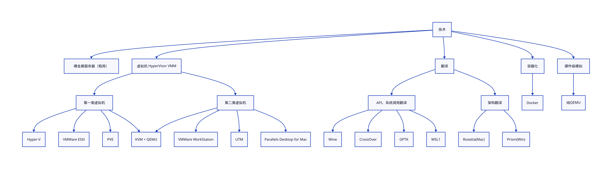
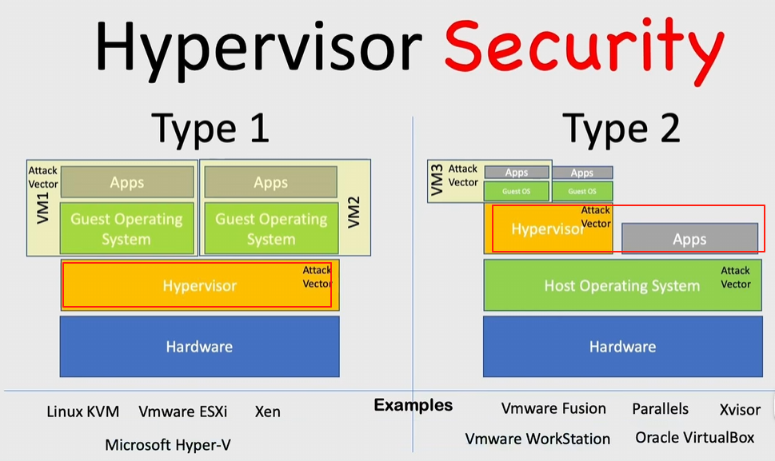

# 虚拟化、转译与算力底座

把一段编译好的二进制程序跑在另一台机器、另一个操作系统、甚至另一种 CPU 架构上，计算机工业界一共演化出了五条技术路线：硬件虚拟化（Hypervisor）、硬件级指令模拟（Emulator）、指令集转译（ISA Translation）、系统调用与 API 转译（Syscall / ABI Translation）、以及操作系统级虚拟化（Container）。

日常折腾虚拟机、WSL2、Docker Desktop、Mac 转译跑 Windows 游戏、或者在电脑上跑掌机模拟器时，之所以容易把各种概念混作一团，是因为很多现代工具其实是上述两三种技术的组合体。把每一层到底在拦截什么、模拟什么拆清楚，再配合系统镜像介质（ISO / IMG / VHDX）的底层结构，整套算力底座就会变得非常透明。

---

## 一、五条算力抽象路线全景对比

先从操作系统与硬件的分界线看起。一个程序运行起来，本质上只做两件事：
1. 普通计算与内存读写：由 CPU 直接执行机器指令（如 x86_64 指令或 ARM64 指令）；
2. 申请外部资源（读写文件、发网络包、建线程、画窗口）：通过 系统调用（Syscall）或系统 API 请求操作系统内核代办。

五类技术的核心区别，就在于它们分别在哪一层做文章：

| 技术路线 | 是否运行独立的客户机内核 (Guest OS) | 是否允许跨 CPU 架构 (如 x86 跑 ARM) | 核心拦截与工作层级 | 代表工具与项目 |
| :--- | :--- | :--- | :--- | :--- |
| 硬件虚拟化 (Hypervisor / VMM) | 是（完整虚拟出一台独立电脑） | 否（Guest 与 Host 必须同架构） | CPU 硬件虚拟化扩展（VT-x / AMD-V），普通指令直通物理 CPU，仅敏感特权指令由 Hypervisor 接管 | KVM、Hyper-V、VMware ESXi / Workstation、PVE、Parallels |
| 硬件级模拟器 (Emulator) | 是（连外设、主板、CPU 一起软件仿真） | 是 | 纯软件逐块翻译目标架构的机器指令（JIT 动态二进制翻译），并软件模拟寄存器、中断控制器与外设 | 纯软件模式的 QEMU (TCG)、Bochs |
| 指令集转译 (ISA Translation) | 否（直接跑在当前宿主系统上，两套程序的目标 OS 相同） | 是（专门解决同系统换芯片架构的过渡） | 操作系统是同一个（如都是 macOS），只把旧架构（x86_64）的机器码提前（AOT）或实时（JIT）翻译成新架构（ARM64）机器码 | Apple Rosetta 2、Windows 11 ARM Prism |
| 系统调用 / API 转译 | 否（不启动目标操作系统内核） | 否（若跨架构需叠加指令集转译） | 在用户空间拦截程序对目标系统（如 Windows Win32 / DirectX）的调用，当场替换成宿主系统（如 Linux / macOS POSIX / Vulkan / Metal）的等价调用 | Wine、Proton、CrossOver、Apple GPTK、早期 WSL1、Cygwin |
| 容器化 (Container) | 否（所有容器共享同一个宿主机 Linux 内核） | 否（跨架构镜像需借助 binfmt_misc + QEMU 用户态转译） | 纯内核态视图隔离（Namespace）与资源配额限制（Cgroup），本质就是宿主机上的普通进程 | Docker、containerd、LXC |



---

## 二、硬件虚拟化：Type-1、Type-2 与 KVM / QEMU 的真实分工

当目标操作系统与物理机拥有相同的 CPU 架构（例如在 x86_64 服务器上跑 x86_64 的 Linux / Windows，或在 Apple Silicon Mac 上跑 ARM64 的 Windows 11），硬件虚拟化是隔离最彻底且性能损耗最小（通常仅 1%~5%）的方案。

它依赖现代 CPU 内置的硬件虚拟化指令集（Intel VT-x、AMD-V、ARM Virtualization Extensions）。开启后，CPU 会分出专门供虚拟机监视器（Hypervisor / VMM）运行的根模式（Root Mode）和供虚拟机运行的非根模式（Non-Root Mode）：虚拟机里 95% 以上的普通运算指令直接在物理 CPU 上全速裸跑，只有当虚拟机内核试图修改全局页表、操作物理 I/O 端口等特权操作时，CPU 才会触发陷入（VM-Exit），交由 Hypervisor 仲裁处理。

### 1. 第一类（Type-1）与第二类（Type-2）虚拟化

教材上按 Hypervisor 安装的位置，将其划分为两类：

```text
Type-1 (裸金属型 Bare-Metal)：
物理硬件 --> Hypervisor (ESXi / Hyper-V / Xen) --> 多个平级的虚拟机 (VM 1, VM 2...)

Type-2 (寄居型 Hosted)：
物理硬件 --> 宿主操作系统 (Windows / macOS / Linux) --> 虚拟化软件 (VirtualBox / VMware Workstation) --> 虚拟机
```



- **Type-1（裸金属型）**：Hypervisor 本身就相当于最底层的微内核操作系统，直接接管物理硬件，所有操作系统都跑在它之上。代表有企业数据中心常用的 VMware ESXi、微软的 Hyper-V、以及开源家用/实验室神器 PVE（Proxmox VE）。
- **Type-2（寄居型）**：像装微信、Steam 一样，在已有的桌面系统里安装一个应用程序，通过宿主机内核模块向宿主系统申请内存和 CPU 时间片。代表有 VirtualBox、VMware Workstation / Fusion、macOS 上的 Parallels Desktop。

### 2. 为什么说开启 Hyper-V 后，你原本的 Windows 自己也变成了虚拟机？

这是一个经常让人困惑的机制：Windows 明明是已经装好的桌面操作系统，在“启用或关闭 Windows 功能”里勾选 Hyper-V 并重启后，为什么它会被归类为 Type-1（裸金属型）？

因为在重启的那一刻，Windows 修改了底层的 UEFI 引导链：
1. 电脑开机时，最先加载进内存夺取硬件控制权的不再是 Windows 内核，而是底层的 Hyper-V Hypervisor；
2. 随后，Hyper-V 启动了你原本的那个 Windows 系统，并将其放进一个拥有最高硬件直通特权的特殊分区，称为 根分区（Root Partition / Parent Partition，即 Dom0）；
3. 你之后在 Hyper-V 管理器里新建的 Ubuntu 或其他虚拟机，则运行在平级的 子分区（Child Partition） 中。

因此，一旦开启了 Hyper-V（或者开启了依赖它的 WSL2、内核隔离/基于虚拟化的安全性 VBS），你日常操作的桌面 Windows 本身其实就已经运行在 Hyper-V 虚拟化层之上了。

这也解释了为什么早年开启 Hyper-V / WSL2 后，VMware Workstation 和安卓模拟器会直接报错崩溃：
- CPU 的硬件虚拟化接口（VT-x / AMD-V）在同一时刻只能被一个顶层 Hypervisor 独占；
- 当 Hyper-V 在开机引导阶段就已经占住了 VT-x，跑在 Windows 里的 Type-2 软件（旧版 VMware、旧版模拟器）再去直接向 CPU 申请 VT-x 指令时，看到的 CPU 根本没有暴露该接口；
- **现代共存方案（WHPX）**：后来微软在 Windows 中提供了一套名为 Windows Hypervisor Platform (WHPX) 的官方用户态 API。新版 VMware Workstation 和现代模拟器检测到 Hyper-V 已开启时，不再尝试自己去抢底层 CPU 的 VT-x，而是改成调用 WHPX 接口，委托底层的 Hyper-V 代为执行虚拟机的 CPU 调度，从而实现了 Docker (WSL2) 与 VMware 的和平共处。

### 3. KVM、QEMU 与 PVE 到底是什么关系？

在 Linux 服务器与云计算领域（各大公有云的云服务器底层几乎清一色是这套组合），KVM 和 QEMU 总是成对出现。它们既不是互相替代的竞品，也很难用死板的 Type-1 / Type-2 去套：

```text
用户态进程 (每个 VM 一个)： QEMU (模拟主板芯片组、PCI 总线、虚拟磁盘、虚拟网卡、显卡与 I/O)
  --[通过 /dev/kvm 字符设备调用 ioctl 接口]-->
Linux 内核态模块：          KVM (借用物理 CPU 硬件虚拟化扩展，直接调度虚拟 CPU 与物理内存映射)
```

- KVM（Kernel-based Virtual Machine）：它是 Linux 内核自带的一个内核模块（`kvm.ko` + `kvm-intel.ko` / `kvm-amd.ko`）。一旦加载 KVM，整个 Linux 内核自己就化身成了一个 Type-1 Hypervisor。但 KVM 极其精简，它只管最核心的两件事：虚拟 CPU 的硬件加速执行和虚拟内存的地址映射，它根本不管硬盘、网卡、显卡、BIOS 这些外设怎么模拟。
- **QEMU（Quick Emulator）**：运行在用户空间的普通进程，有两种截然不同的工作模式：
  1. **纯软件模拟模式（TCG 引擎）**：不依赖 KVM，可以在 x86 电脑上纯靠软件翻译跑起树莓派 ARM 或 RISC-V 的完整系统。功能万能，但因为每条指令都要软件转译，速度较慢。
  2. KVM 硬件加速模式（`qemu-system-x86_64 --enable-kvm`）：这就是云服务器的标准形态。QEMU 退居幕后当“主板和外设管家”（在用户空间模拟网卡、磁盘控制器、串口、VGA 显示），而把所有繁重的 CPU 指令执行和内存访问通过 `/dev/kvm` 交给内核里的 KVM 直接扔上物理 CPU 跑。
- PVE（Proxmox Virtual Environment）：一个基于 Debian Linux 打包好的开源服务器系统，底层直接集成了 KVM + QEMU（跑完整虚拟机） 和 LXC（跑轻量系统容器），并在外面套了一层好用的 Web 管理面板与集群存储管理工具，装在物理机上就能直接当开源版 ESXi 用。
- **UTM（macOS）**：把 QEMU（以及苹果原生的 Virtualization.framework）包装了一层 macOS 原生图形界面的外壳软件，省去了手敲几十个 QEMU 命令行参数的痛苦。

---

## 三、WSL1 vs WSL2 与桌面虚拟机的内部结构

在 Windows 上做开发，WSL（Windows Subsystem for Linux）的演进恰好是从“系统调用转译”跨向“轻量级硬件虚拟化”的活教材。

### 1. WSL1（系统调用翻译层）与 WSL2（托管轻量级 VM）

- **WSL1**：微软在 Windows 内核里写了一层极其庞大的 `lxcore.sys` 驱动，当你在里面跑 Linux 二进制程序、发出 Linux 系统调用（如 `fork`、`epoll`、`open`）时，Windows 当场把它翻译成等价的 Windows NT 内核调用。
  - **优点**：没有虚拟机内存开销，跟 Windows 互访文件极快；
  - **致命缺陷**：没有真正的 Linux 内核。一旦遇到强依赖 Linux 内核特性的软件（如 Docker 依赖的 `namespace/cgroup/overlayfs`、eBPF、内核模块），或者语义难以一比一对齐的文件锁，就会直接罢工。
- **WSL2**：彻底推翻了翻译路线，改为基于 Hyper-V 的 Utility VM（轻量级托管虚拟机），里面跑着一个微软官方维护并编译的 100% 真实 Linux 内核。

### 2. WSL2 的“单内核、多发行版”架构真相

很多人用 `wsl --list -v` 看到列表里有 `Ubuntu-24.04`、`Debian`、`docker-desktop` 好几个条目，会误以为后台开了三台独立的虚拟机；去打开 Hyper-V 管理器面板，却又一台都找不到。

它的真实底层拓扑如下：

```text
Windows 宿主机 (Hyper-V 根分区)
  --> 1 个隐藏的 WSL2 轻量级虚拟机 (不在 Hyper-V 管理器显示，运行唯一一个共享的 Linux 内核)
        --> 容器化隔离的发行版实例 1: Ubuntu-24.04 (独立的根文件系统 ext4.vhdx)
        --> 容器化隔离的发行版实例 2: docker-desktop (运行 dockerd / containerd 守护进程)
              --> Docker 容器 A / 容器 B / 容器 C (全部共享上面同一个 WSL2 Linux 内核)
```

1. 为什么 Hyper-V 管理器里看不到 WSL2？
   WSL2 使用的是 Hyper-V 底层的轻量级主机计算服务（HCS, Host Compute Service），由 Windows 系统服务直接按需拉起和动态伸缩内存，不走传统的重量级独立 VM 管理列表。
2. **多个 WSL2 发行版是如何共存的？**
   不管你在 WSL2 里装了几个 Linux 发行版，底层自始至终只启动了 1 台 WSL2 虚拟机、只跑着 1 个 Linux 内核。各个发行版（包括 `docker-desktop`）其实是以类似容器（Namespace 隔离）的方式，各自挂载自己的 `ext4.vhdx` 虚拟磁盘，共享这同一个 Linux 内核。
3. Docker Desktop 在 Windows / macOS 上的本质：
   因为 Docker 容器必须依赖 Linux 内核，而 Windows 和 macOS 的内核分别是 NT 和 XNU，所以 Windows 和 macOS 上永远不可能原生直接跑 Linux 容器。
   - 在 Windows 上，Docker Desktop 在同一个 WSL2 虚拟机里创建了 `docker-desktop` 实例来跑 `dockerd`，数据统一存在 `%LocalAppData%\Docker\wsl\disk\docker_data.vhdx`；
   - 在 macOS 上，Docker Desktop（以及更轻量的替代品 OrbStack、Colima）同样是在后台默默启动了一台极轻量的 Linux 虚拟机（基于苹果官方的 `Apple Virtualization.framework` 或 `Docker VMM`），虚拟磁盘位于 `~/Library/Containers/com.docker.docker/Data/vms/0/data/Docker.raw`，所有容器都跑在这台隐藏的 Linux 虚拟机里。

### 3. 桌面虚拟机的 GPU 加速与同架构法则

- **同架构虚拟化原则**：在 Apple Silicon（M 系列 ARM 芯片）的 Mac 上用 Parallels Desktop 或 VMware Fusion 装 Windows 虚拟机，主流装的都是 Windows 11 on ARM。因为宿主和客户机都是 ARM64，指令无需转译直接上物理核心，性能损耗极低；如果强行在 M 芯片上用 QEMU 软模拟一台 x86_64 的 Windows，所有指令都要走软件翻译，会卡到无法日常使用。
- **虚拟机的 GPU 是怎么工作的？**
  - PCIe 显卡直通（GPU Passthrough / VFIO）：在 Linux (PVE/KVM) 上，可以把物理独立显卡直接从宿主机剥离，独占式挂给某一台虚拟机，性能接近 100%，但宿主机和其他虚拟机就不能再用这张卡了。
  - 半虚拟化图形 API 转发（Paravirtualized GPU）：Parallels Desktop 在 macOS 上跑 Windows 或虚拟 macOS 依然能流畅打游戏、跑 3D 动画，并不是把整个 GPU 硬件独占切给了虚拟机，而是给虚拟机装了专用虚拟显卡驱动：把虚拟机内部的 DirectX / Metal 绘图指令拦截下来，通过共享内存高速通道转发给宿主机的 macOS Metal 引擎，由宿主机物理 GPU 代为渲染后再把画面帧贴回窗口，实现多系统共享同一块物理 GPU。
  - **WSL2 的 GPU-PV**：Windows 上的 WSL2 之所以能直接调 NVIDIA 显卡跑 PyTorch / CUDA，靠的也是微软与 NVIDIA 合作的半虚拟化通道（`/dev/dxg`）：Windows 宿主机只需安装正常的显卡驱动，WSL2 内部不需要装 Linux 显卡内核驱动，CUDA 调用会直接穿透给宿主机的 Windows 驱动执行。

---

## 四、跨架构与跨系统转译：不启动虚拟机的“偷梁换柱”

如果不想背负一整台虚拟机的内存与启动开销，只想让为 A 平台编译的程序直接在 B 平台上跑起来，就需要用到转译（Translation）技术。这里一定要分清“转译 CPU 指令”和“转译操作系统 API”是两个完全正交的维度。

### 1. 指令集转译：Rosetta 2 与内存模型（TSO vs WMO）硬件黑科技

当苹果从 Intel (x86_64) 迁移到自研 M 系列芯片 (ARM64) 时，旧软件本身就是为 macOS 编写的，它调用的系统 API 完全没变，唯一的障碍是二进制文件里的机器码是 x86_64 的。

Rosetta 2（以及 Windows 11 ARM 上的 Prism）只做一件事：在程序首次安装或启动时，把 x86_64 机器码翻译成 ARM64 机器码。

深度追问：为什么跨架构转译通常极慢，但苹果的 Rosetta 2 却能达到原生 70%~80% 甚至更高的惊人性能？

除了 AOT（提前编译）优化外，最核心的秘密在于 CPU 内存一致性模型（Memory Ordering Model）：
- x86_64 是强内存模型（TSO, Total Store Order）：x86 硬件架构规定，CPU 对内存的读写顺序约束极严，几乎不允许乱序重排写入操作。写 x86 多线程代码的程序员和编译器早已习惯了这种“硬件替你兜底顺序”的死板规则。
- ARM64 是弱内存模型（WMO, Weak Memory Ordering）：为了追求极致的能效比和流水线并行度，ARM 允许 CPU 在不影响单线程逻辑的前提下，大幅度乱序重排内存读写指令。
- **纯软件转译的死穴**：当用 ARM CPU 去模拟运行 x86 代码时，为了防止多线程程序因为 ARM 的乱序执行而产生诡异的数据竞争崩溃，纯软件模拟器被迫在几乎每一条翻译出来的内存读写指令后面，强行插入昂贵的 内存屏障指令（Memory Barrier，`DMB`），这会把 CPU 流水线彻底卡死，性能暴跌。
- **苹果的作弊级硬件外挂**：苹果在设计 M 系列芯片时，直接在物理硅片里塞进了一个隐藏的 硬件级 TSO 开关！只要操作系统检测到当前进程是通过 Rosetta 2 运行的，就会触发寄存器把这颗 ARM 核心强行切换到 x86 的 TSO 强内存排序模式——不需要在软件里插任何一条内存屏障指令，直接从物理硬件层面消除了 x86 转 ARM 最大的性能鸿沟。

（反过来，在 x86 电脑上模拟 ARM 架构，比如电脑跑 Android / Switch 模拟器，因为是用约束更严的 TSO 强模型去跑允许乱序的 WMO 弱模型，天然兼容，在内存模型上反而不容易翻车。）

### 2. 系统调用与图形 API 转译：Wine、Proton、CrossOver 与 GPTK

如果 CPU 架构相同（都是 x86_64），但想在 Linux 或 macOS 上直接跑 Windows 的 `.exe` 程序和 3A 游戏呢？

- Wine（Wine Is Not an Emulator）：由开源社区维护（Valve 深度资助）。它不虚拟硬件，也不启动 Windows 内核，而是用纯开源代码从头重写了一整套 Windows 的核心动态链接库（`ntdll.dll`、`kernel32.dll`、`user32.dll` 等）。当 `.exe` 调用 Win32 API 时，Wine 当场把它转换成 Linux / macOS 的 POSIX 调用。（根据 Google 与 Oracle 关于 Java API 的经典判例，重新实现接口规范并不构成侵权。）
- **DXVK 与 VKD3D**：光转译操作系统的文件/线程 API 还跑不了游戏，因为 Windows 游戏画图用的是微软独占的 DirectX 9/10/11/12。DXVK 和 VKD3D 负责把游戏的 Direct3D 图形调用实时翻译成跨平台的 Vulkan 图形接口。
- Proton（Steam Deck 封神的核心基石）：Valve 将 `Wine + DXVK + VKD3D + Fsync/Esync（同步原语加速）+ 手柄/音频适配` 打包整合成的一键式兼容层。你在 Linux 或 Steam Deck 上点“开始游戏”，Proton 就在后台把整套 Windows 调用无缝转成 Linux 原生调用，性能甚至偶尔反超原生 Windows（唯一的拦路虎是部分要求深入 Windows 内核驱动的内核级反作弊系统）。
- **CrossOver**：CodeWeavers 公司（也是 Wine 核心开发商）出品的商业软件。内核基于开源的 Wine，外面套了闭源易用的图形化容器管理壳并针对特定商业软件（如 Office、游戏）做了专属补丁。
- GPTK（Apple Game Porting Toolkit）：在 M 系列 Mac 上跑现代 Windows 64 位 DirectX 12 游戏的终极套娃组合：

```text
Windows x86_64 游戏 (.exe)
  --> CPU 路线： Rosetta 2 (x86_64 指令 --> ARM64 指令) + Wine (Win32 API --> macOS POSIX API)
  --> GPU 路线： GPTK D3DMetal (DirectX 11/12 图形指令 --> Apple Metal 图形指令)
```

### 3. 游戏机与手机模拟器：LLE 低阶模拟 vs HLE 高阶模拟

在 x86_64 的 Windows 电脑上跑 Android 手游模拟器（如 MuMu、雷电）或 Switch 模拟器（如 Yuzu / Ryujinx），走的又是两条不同的混合路线：

1. Android 模拟器（本质是虚拟机 + 应用内 ARM 转译）：
   - 底层其实是一台基于 Hyper-V 或 VirtualBox 驱动的 x86_64 Android 虚拟机（因为 Android 底层就是 Linux 内核，编译出 x86_64 版本的 Android 系统直接在电脑 CPU 上硬件虚拟化跑，系统本身完全不需要跨架构模拟），并由模拟器外壳伪造出 GPS、陀螺仪、Wi-Fi、通知栏等虚拟外设；
   - 只有当手游安装包里包含了纯 ARM 架构的 `.so` 原生库时，Android 系统内部才会调用 Intel Houdini 或 Google `ndk_translation`（类似 Rosetta 的动态二进制转译器）把 ARM 指令转成 x86 指令执行；图形渲染则将 OpenGL ES / Vulkan 调用直接穿透转发给宿主机的物理显卡驱动。
2. Switch 模拟器（HLE 高阶模拟 + JIT 重编译）：
   - Switch 掌机运行的是任天堂自研的 `Horizon OS` 微内核系统（并非 Linux 或 Android），芯片是标准的 ARMv8（Tegra X1）。
   - 如果采用 LLE（Low-Level Emulation，低阶模拟），去一比一模拟整块主板电路并把原版 Horizon OS 跑起来，性能开销会大到无法接受；
   - 因此现代主机模拟器普遍采用 HLE（High-Level Emulation，高阶模拟）：根本不启动 Horizon OS，而是像 Wine 一样，用 C++ / Rust 在宿主机上直接重写一套与 Horizon OS 接口完全一致的系统服务（文件读取、音频、手柄输入、线程调度）；至于游戏本身的 ARMv8 机器码，则通过专门的 JIT 引擎（如 `Dynarmic`）实时重编译为宿主机的 x86_64 指令，并把针对 Nvidia Maxwell 架构的 NVN 专有图形指令反编译重构为标准的 Vulkan / OpenGL 着色器交给电脑显卡执行。

---

## 五、附：Cygwin、MinGW 与 MSYS2 到底在干什么？

既然提到了 Wine（在 Linux 上把 Win32 翻译成 POSIX），就顺带彻底厘清它反过来的三兄弟——在 Windows 上跑 Linux 工具或 GCC 编译器的 Cygwin、MinGW-w64 与 MSYS2。很多人装了 Git for Windows 或在 Windows 上配 C/C++ 环境时都会见到它们，三者的定位有着清晰的历史演进：

| 工具名称 | 核心本质 | 编译出来的 `.exe` 依赖什么？ | 适用场景 |
| :--- | :--- | :--- | :--- |
| Cygwin | POSIX 系统调用翻译层（一个巨大的 `cygwin1.dll`，方向与 Wine 刚好相反） | 必须带着 `cygwin1.dll` 才能跑；程序内部写的依然是 Linux 的 `fork()`、`/dev/null` 等 POSIX 接口，由该 DLL 在运行时翻译成 Win32 API | 把重度依赖 POSIX 特性的纯 Linux 源码一字不改地先在 Windows 上编译跑起来 |
| MinGW-w64 | 原生 Windows 版的 GCC / Clang 编译器工具链（Minimalist GNU for Windows） | 纯原生 Windows 程序，直接链接 Windows 系统自带的 C 运行库（UCRT / MSVCRT），不需要任何第三方翻译 DLL；但源码里不能写 Linux 专有的 POSIX 头文件（如 `<sys/epoll.h>`、`<unistd.h>` 的 `fork`），只能用标准 C/C++ 或 `<windows.h>` | 想在 Windows 上用 GCC/Clang 代替微软 MSVC (`cl.exe`) 编译出纯净的原生 Windows 软件 |
| MSYS2 | 打包好的轻量 Cygwin 终端外壳 + `pacman` 包管理器 + MinGW-w64 编译器套件 | 取决于你在它里面选哪个子环境：用 `mingw64 / ucrt64` 工具链编出来的是纯原生 Windows `.exe`；只有用 `msys` 自身环境编出来的才依赖 `msys-2.0.dll` | 为 MinGW-w64 提供 `bash`、`make`、`autotools`、`pkg-config` 等 Unix 构建脚手架，让你能在 Windows 上舒服地执行 `./configure && make` 编出原生 `.exe`（Git for Windows 附带的 Git Bash 就是裁剪版的 MSYS2） |

简言之：MinGW 是编译器（对标 MSVC 的 `cl.exe`），Cygwin 是运行时 POSIX 翻译层（反向 Wine），而 MSYS2 是帮你用 Unix 命令和 `pacman` 管理并调用 MinGW 的构建工作台。

---

## 六、镜像介质与虚拟机代际：ISO、IMG、WIM 与 VHDX

经常安装物理机、Hyper-V 虚拟机或刷软路由（如 OpenWrt），总会遇到 `.iso`、`.img`、`.wim`、`.esd`、`.vhdx`、`.qcow2` 等五花八门的镜像后缀。为什么有的 `.img` 改个后缀就能当 `.iso` 用，而 OpenWrt 的 `.img` 用尽办法也转不成 `.iso`？

### 1. 三类完全不同层级的“镜像文件”

不要看后缀名，要看文件内部包含的数据结构层级：

```text
层级 A：纯文件系统归档包 (无分区表、无扇区引导头，只存文件树与增量数据块)
  --> 代表：.zip / .tar.gz / Windows 安装盘里的 install.wim 与 install.esd

层级 B：光盘映像 (Optical Disc Image，按光盘轨道文件系统 ISO 9660 / UDF 组织)
  --> 代表：.iso (以及部分由光盘直接抓轨生成的早期 .img)
  --> 内部结构：[光盘引导记录 El Torito] + [ISO 9660/UDF 文件系统元数据] + [安装程序文件目录]

层级 C：完整整盘块设备映像 (Raw Disk / Virtual Disk Image，一比一对应一块物理硬盘)
  --> 代表：OpenWrt/树莓派的 .img (裸盘扇区流)、Hyper-V 的 .vhdx、QEMU/PVE 的 .qcow2、VMware 的 .vmdk
  --> 内部结构：[MBR 或 GPT 分区表] + [分区 1: EFI/Boot 引导分区 (FAT32)] + [分区 2: Rootfs 系统根分区 (ext4 / SquashFS / NTFS)]
```

从这张结构图可以瞬间推导出一系列实操结论：

1. 为什么做启动 U 盘必须用 Rufus / Ventoy，而不能直接把 ISO 解压复制进 U 盘？
   直接解压复制只拿走了里面的“第 3 部分（普通文件与文件夹）”，把光盘扇区头部的引导信息丢掉了。主板 BIOS（Legacy 模式下）去读 U 盘首扇区找不到引导代码，就会直接跳过 U 盘。（不过在现代纯 UEFI 模式下，由于 UEFI 固件本身认识 FAT32 分区并会自动寻找分区根目录下的 `/EFI/BOOT/BOOTX64.EFI` 文件，有时把纯 UEFI 结构的 Windows ISO 解压进 FAT32 格式的 U 盘也能引导，但遇到超过 4GB 的单个文件又会被 FAT32 拦住，因此用 Ventoy 或 Rufus 依然是最稳妥的标准做法。）
2. Windows ISO 里面的 `.wim` 和 `.esd` 是什么？
   打开一个 Windows 原版安装 ISO，占体积 90% 以上的是 `sources/install.wim` 或 `install.esd`。它们属于上面说的层级 A（基于文件的归档映像）：微软将家庭版、专业版、教育版的文件放在同一个 `.wim` 里，相同的文件只存一份（单实例存储去重），所以包含五六个版本体积也几乎不增加。`.wim` 方便挂载修改，而 `.esd` 采用了极限高压缩率算法，体积小 30% 左右，更适合网络下载但极难直接修改。
3. 为什么 OpenWrt 的 `.img` 死活转不成 `.iso`？
   因为 Ubuntu/Windows 的 `.iso` 是“系统安装光盘”（需要引导起来，再由安装程序把系统写进你的目标硬盘）；而 OpenWrt 或树莓派发行的 `.img` 根本不是光盘，它是“已经装好系统的整块硬盘裸镜像（层级 C）”——里面自带了 MBR/GPT 分区表以及格式化好的 `ext4 / SquashFS` Linux 分区。你拿 UltraISO（只认识光盘结构的工具）去打开一块带有 Linux 分区表的硬盘镜像，自然无法识别。

### 2. 在 Hyper-V 中部署虚拟机与软路由 `.img` 的标准姿势

Hyper-V 新建虚拟机时会让你选择 第一代（Generation 1） 还是 第二代（Generation 2），一旦选定创建后无法更改：

| 特性维度 | 第一代虚拟机 (Gen 1) | 第二代虚拟机 (Gen 2) |
| :--- | :--- | :--- |
| 固件引导方式 | 传统 Legacy BIOS（通过读取磁盘首扇区 MBR 引导） | 现代 UEFI 固件（通过读取 EFI 分区下的 `.efi` 引导文件启动） |
| 虚拟硬件模拟 | 模拟老旧的 IDE 控制器、传统百兆网卡 | 全系采用高性能半虚拟化 SCSI 控制器、合成千兆/万兆网卡，启动更快 |
| 安全启动 (Secure Boot) | 不支持 | 默认开启（装 Linux 时需将安全启动模板从“Microsoft Windows”改为 “Microsoft UEFI 证书颁发机构”，或直接取消勾选安全启动，否则会报错拒载内核） |
| 适用场景 | 老旧系统、采用传统 MBR 分区表的软路由镜像（如部分 OpenWrt 固件） | Windows 10/11、Ubuntu 22.04/24.04 等所有现代 64 位操作系统 |

- Gen 2 安装现代 Linux 后的重启循环小坑：从 ISO 安装完 Ubuntu 提示重启时，如果在固件启动顺序里依然把“DVD 驱动器”排在第一位，重启后又会进安装界面。只需在虚拟机设置 $\rightarrow$ 固件里，将“硬盘驱动器（或对应的 ubuntu EFI 启动项）”上移到第一位即可。
- 在 Hyper-V 中最快跑起 OpenWrt `.img` 的方法：
  既然 OpenWrt 的 `.img` 本质上就已经是一块裸硬盘（Raw Disk），完全不需要走“光盘安装”流程，直接用 `qemu-img` 把裸盘流转换成 Hyper-V 的虚拟硬盘格式 `.vhdx` 挂上去就能开机：

  ```bash
  # 将 gzip 解压后的 openwrt.img 裸盘镜像一键转换为动态扩展的 Hyper-V 虚拟硬盘 (.vhdx)
  qemu-img convert -f raw -O vhdx openwrt-x86-64-generic-ext4-combined.img openwrt.vhdx
  ```

  随后新建一台第一代（若刷的是 `combined-efi.img` 则可选第二代并关闭安全启动）虚拟机，在“连接虚拟硬盘”一步直接选择刚才转出来的 `openwrt.vhdx`，开机连接并敲一下回车，3 秒钟就能直接进 OpenWrt 终端。
