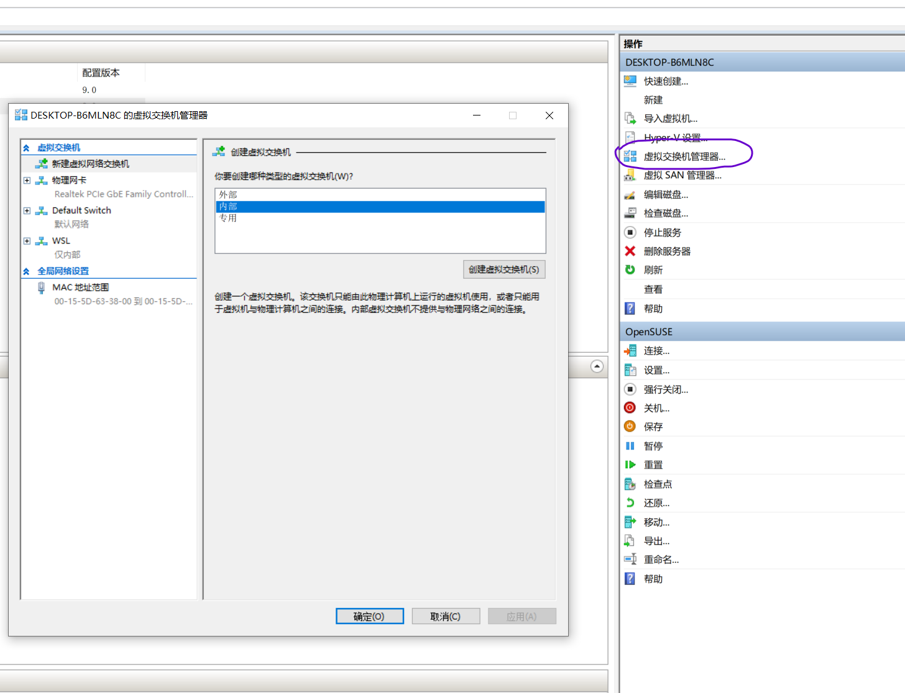
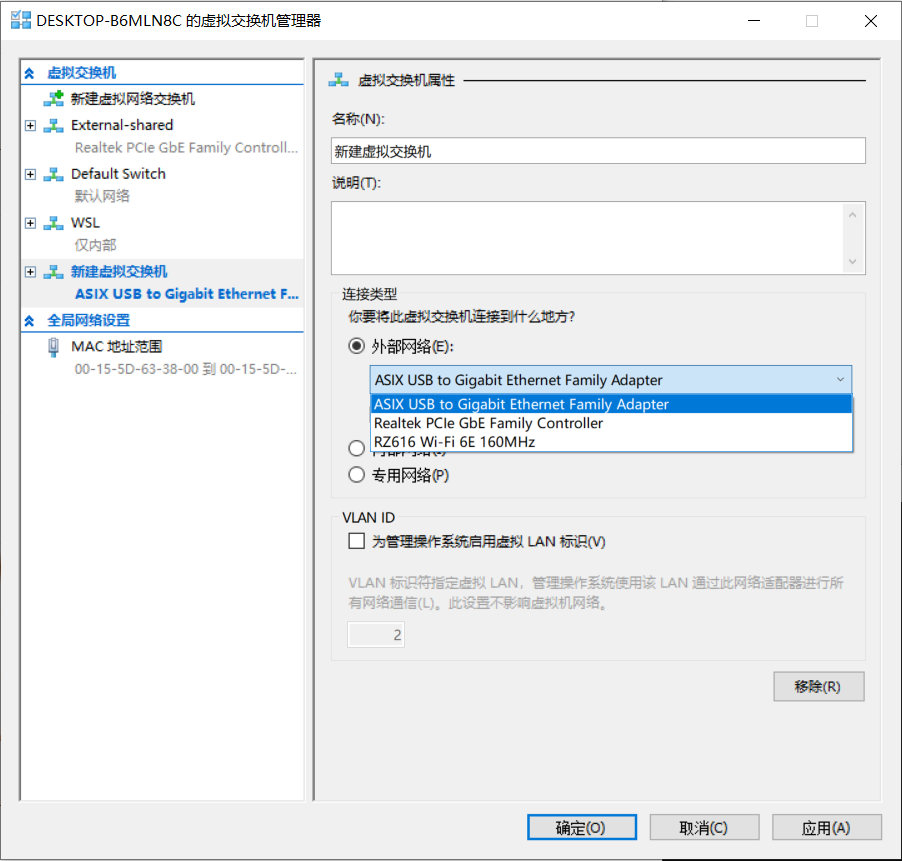

# 分层模型、网卡与路由基础

这一篇聚焦最底层的一个问题：**一个数据包从本机程序发出后，如何穿过协议栈、路由表、虚拟网卡和物理网卡，最终离开主机？**

把 L2 / L3 / L4 / L7 的职责边界、IP 网段与路由规则、虚拟网络设备以及 MTU / MSS 这些基本功立稳，后续理解传输层状态机、NAT 穿透、VPN 隧道与代理分流才会有一条清晰的主线。

---

## 一、网络分层：为什么工程里只提 L2 / L3 / L4 / L7？

教科书里的 OSI 七层模型（物理、数据链路、网络、传输、会话、表示、应用）在实际工程和抓包分析里很少按七层严格拆分，日常沟通普遍按 **TCP/IP 四层（沿用 OSI 层号）** 来指代：

| 工程简称 | 层级名称 | 核心地址 / 标识 | 负责什么 | 常见协议与设备 |
| :--- | :--- | :--- | :--- | :--- |
| **L2** | 数据链路层 | **MAC 地址** | **同一局域网（同网段）** 内，把帧从一块网卡送到下一块网卡（如电脑 → 路由器） | 以太网（Ethernet）、Wi-Fi、ARP、交换机（Switch / vSwitch）、**TAP 虚拟网卡** |
| **L3** | 网络层 | **IP 地址** | **跨网段**寻路（查路由表决定下一跳发给谁），不保证送达、不保证顺序 | IPv4 / IPv6、ICMP（`ping`）、路由器、**TUN 虚拟网卡** |
| **L4** | 传输层 | **端口号（Port）** | 定位到主机上的**具体进程**；TCP 提供可靠有序字节流，UDP 只负责尽力发包 | TCP、UDP |
| **L7** | 应用层 | 域名 / URL / 协议语义 | 具体业务的数据格式与交互逻辑 | HTTP/HTTPS、SSH、DNS、SOCKS5、Nginx 反向代理 |

> 为什么中间没有 L5/L6？OSI 的会话层和表示层（例如 TLS 加密协商）在现代协议实现里大多融合进了应用层与传输层之间，因此工程上只保留 **L2、L3、L4、L7** 这四个最实用的坐标。

### 核心原理：封装与“下层载荷盲视”

数据每往下一层传递，上一层的完整数据都会被当成**载荷（Payload）**，在前面拼上本层的头部（Header），这个过程叫**封装（Encapsulation）**：

```text
应用层产生数据：                  [ 应用层数据 ]
  ↓ 交给 L4（TCP）加端口/序号：    [ TCP 头 | 应用层数据 ]
  ↓ 交给 L3（IP）加源/目的 IP：    [ IP 头 | TCP 头 | 应用层数据 ]
  ↓ 交给 L2（以太网）加 MAC：      [ MAC 头 | IP 头 | TCP 头 | 应用层数据 ]
```

**一条极其重要的底层特性：任何一层协议对自己的载荷都是完全“盲视”的。**

在操作系统内核眼里，L4 的 TCP 或 UDP 根本不知道、也不关心自己搬运的字节流是网页文本、文件，还是**另一个完整的 IP+TCP 数据包**。只要用户态程序把内层的整套数据包当成普通二进制字节，写进外层的 Socket，外层协议栈就会照单全收，再给它套上外层的传输层头和 IP 头发送出去：

```text
[ 外层 IP 头 ][ 外层 UDP/TCP 头 ][ 加密载荷( [ 内层 IP 头 ][ 内层 TCP 头 ][ 应用数据 ] ) ]
```

分层模型是**可以递归嵌套的逻辑封装**，而不是不可叠加的物理限制。绝大多数 VPN 隧道之所以能在公网上传输私有网段的完整 IP 包，靠的正是这一机制。

### 用分层直接解释两个日常现象

1. **为什么 `ping` 不能用来测试 HTTP / SOCKS5 代理是否生效？**
   - `ping` 使用的是 **L3 的 ICMP 协议**，没有端口号，也不会读取 `HTTP_PROXY` 等环境变量，压根不经过应用层（L7）的代理软件。验证应用层代理必须使用 `curl` 或浏览器等应用层客户端。
2. **为什么同一个内网 IP，`ssh` 直连正常，但 `curl http://...` 却可能超时或 502？**
   - `ssh` 默认不读取 `HTTP_PROXY` 环境变量，直接把目标 IP 交给内核 **L3 路由表** 选路出去；
   - 而遵循 `HTTP_PROXY` 的 HTTP 客户端在 **L7 应用层** 就先把请求拐去了本地代理端口（如 `127.0.0.1:10808`），如果代理软件没配置绕过该网段，流量根本不会走到内核原本的直连路由。

---

## 二、IP、CIDR 与常见地址段

### 1. CIDR 是什么？（`/24`、`/16`、`/10` 怎么算）

IPv4 地址本质上是一个 **32 位二进制数**，每 8 位转成一组十进制并用点分隔（如 `192.168.0.1`）。

**CIDR（Classless Inter-Domain Routing，无类别域间路由）** 用 `IP/前缀长度` 来表示一个连续网段。斜杠后的数字 `N`，表示**前 `N` 个二进制位固定作为网络号**，剩下的 `32 - N` 位可以自由分配给网段内的主机：

| CIDR 写法 | 固定前缀位数 | 地址范围 | 地址总数 | 常见用途 |
| :--- | :--- | :--- | :--- | :--- |
| `192.168.0.195/32` | 前 32 位全固定 | 仅 `192.168.0.195` | 1 个 | 单台主机精确路由 |
| `192.168.0.0/24` | 前 24 位（前 3 段） | `192.168.0.0` ~ `192.168.0.255` | $2^8 = 256$ | 常见家用/办公室局域网 |
| `172.16.0.0/12` | 前 12 位 | `172.16.0.0` ~ `172.31.255.255` | $2^{20} \approx 104\text{ 万}$ | Docker 默认网桥、企业内网常用段 |
| `100.64.0.0/10` | 前 10 位 | `100.64.0.0` ~ `100.127.255.255` | $2^{22} \approx 419\text{ 万}$ | **CGNAT 共享地址空间（也被 Tailscale 选用）** |
| `0.0.0.0/0` | 前 0 位（全不固定） | 所有 IPv4 地址 | 全部 | **默认路由（兜底路由）**，所有未命中明细路由的包走这里 |

### 2. RFC 1918 私网 vs RFC 6598（CGNAT）

- **RFC 1918（传统私有局域网 IP）**：互联网规范专门预留给家庭、企业内网自由复用、不在公网路由的三大地址段：
  - `10.0.0.0/8`（`10.x.x.x`）
  - `172.16.0.0/12`（`172.16.x.x` ~ `172.31.x.x`）
  - `192.168.0.0/16`（`192.168.x.x`）
- **RFC 6598 / CGNAT（运营商级 NAT 地址空间：`100.64.0.0/10`）**：
  - 随着公网 IPv4 枯竭，运营商无法给每条宽带分配独立公网 IP，于是在机房侧再加一层大 NAT（Carrier-Grade NAT）。
  - 如果运营商直接用 `192.168.x.x` 或 `10.x.x.x` 给用户拨号接口发地址，会和用户自家路由器或公司内网网段撞车。因此 RFC 6598 专门划出 `100.64.0.0/10` 作为运营商内部共享地址空间。
  - **为什么组网软件（如 Tailscale）也偏爱 `100.64.0.0/10`？** 同样是为了避免与绝大多数家庭和企业已占用的 RFC 1918 私网冲突。
  - **常见配置盲区**：由于 `100.64.0.0/10` 属于 RFC 6598 而**不属于**传统 RFC 1918 私网，许多代理软件默认的“绕过局域网 IP（如 `geoip:private`）”规则并不覆盖它，使用白名单分流模式时往往需要手动放行该网段。

---

## 三、网卡、路由表与虚拟网络设备

### 1. 路由表如何决定流量走哪张网卡？

一台主机可以同时挂载多张物理网卡和虚拟网卡（有线、Wi-Fi、虚拟机网桥、Docker、VPN 虚拟网卡等）。系统为每张网卡配置独立 IP，并通过**内核路由表**决定去往任意目标 IP 的数据包该从哪张网卡发出、交给哪个下一跳网关：

- Windows：`route print`
- Linux：`ip route get <目标IP>`（直接打印命中哪条路由、走哪张网卡、用哪个源 IP）
- macOS：`route get <目标IP>`

内核查路由表遵循 **最长前缀匹配（Longest Prefix Match）** 原则：目标 IP 同时命中多条规则时，优先走前缀长度（`/N`）最大的那一条。

- 例如同时存在 `0.0.0.0/0 → 物理网卡 en0` 和 `100.64.0.0/10 → 虚拟网卡 utun`：
  - 访问 `100.64.0.22` 时，前缀 `10 > 0`，精准命中虚拟网卡；
  - 访问公网 `8.8.8.8` 时，不命中任何明细路由，兜底走 `0.0.0.0/0` 经物理网卡发往默认网关（路由器）。

### 2. 虚拟网络设备：vSwitch、TAP、TUN 与 `utun`

当主机上运行虚拟机、容器、VPN 或代理 TUN 模式时，操作系统会在软件层面创建虚拟网络设备：

| 设备名 | 工作层级 | 进出的数据单元 | 特点与典型用途 |
| :--- | :--- | :--- | :--- |
| **vSwitch（虚拟交换机）** | **L2** | 以太网帧（带 MAC） | 软件实现的二层交换机，连接宿主机、多台虚拟机的虚拟网卡以及物理网卡，按 MAC 地址转发帧（如 Hyper-V 虚拟交换机、Docker 网桥 `docker0`） |
| **TAP** | **L2** | 完整以太网帧（带 MAC 头） | 模拟完整的物理以太网卡，支持广播、ARP、DHCP。常用于虚拟机网卡、需要二层桥接的 VPN（如 OpenVPN TAP 模式） |
| **TUN** | **L3** | 纯 IP 包（无 MAC 头） | 只收发网络层 IP 包，省去以太网帧头和广播开销，效率更高。绝大多数现代 VPN 和代理内核（WireGuard、Tailscale、Xray / sing-box / Mihomo TUN 模式）都使用 TUN |
| **`utun`** | **L3（TUN 的 macOS/BSD 名称）** | 纯 IP 包 | macOS / BSD 内核提供给用户态进程创建的 TUN 虚拟网卡，设备名形如 `utun0`、`utun3`、`utun4`（Linux 下通常叫 `tun0` 或自定义名称如 `tailscale0`） |

**TUN 网卡的工作闭环**：
- 物理网卡的一端接内核协议栈，另一端接网线或无线芯片；
- TUN 虚拟网卡的一端接内核协议栈，**另一端接某个用户态进程打开的文件描述符**。
- 当内核查路由表把一个 IP 包写入 `utun` / `tun0` 时，包并不会直接进网线，而是被对应的用户态程序（如 VPN 客户端或代理内核）读取到内存里处理（加密封装或转发），再通过普通公网 Socket 经物理网卡真正发出去。

---

## 四、实例：单物理网卡下的 Hyper-V 虚拟网络拓扑

假设一台 Windows 宿主机只有一张物理网卡，通过网线连接路由器；同时在上面开启了 Hyper-V 并创建了一台 Linux 虚拟机。

### Hyper-V 的三种虚拟交换机（vSwitch）

Hyper-V 的“虚拟交换机管理器”提供**外部、内部、专用**三种交换机，并默认附带一个名为 `Default Switch` 的交换机：



- **专用网络（Private）**：仅虚拟机之间互通，与宿主机和外网完全隔离，较少使用。
- **内部网络（Internal）**：仅宿主机和虚拟机之间互通；配合宿主机的 NAT 服务后，虚拟机即可借助宿主机上网。系统自带的 `Default Switch`（WSL2 也依赖它）本质上就是自动配置了 NAT 的内部网络。
- **外部网络（External）**：必须绑定到一块物理网卡上，相当于把虚拟机直接桥接到宿主机所在的物理局域网中。

创建外部交换机时，勾选框 **“允许管理操作系统共享此网络适配器”** 的含义：
- “管理操作系统”指运行 Hyper-V 宿主的 Windows 本身。
- **勾选**：Windows 宿主机和 Linux 虚拟机共用这张物理网卡；
- **不勾选**：物理网卡完全独占给虚拟机使用（双网卡机器可以不勾，让虚拟机独占网线、宿主机走 Wi-Fi）。



### 开启外部虚拟交换机后的实际拓扑

开启前，单机直接连路由器：

```text
Windows --> 物理网卡 --> 路由器 --> Internet
```

开启外部虚拟交换机并勾选共享后，拓扑变为：

```text
Windows --> 虚拟网卡 (MAC: C4-C6-E6-34-C1-3F) --> 虚拟交换机 (vSwitch) --> 物理网卡 (二层透传口) --> 路由器 --> Internet
Linux   --> 虚拟网卡 (MAC: 00:15:5d:63:38:07) --> 虚拟交换机 (vSwitch)
```

此时用网络命令观察会看到三个典型现象，背后正好对应前面讲的 L2 交换机与虚拟网卡机制：

1. **物理网卡变成了透明的二层上行口**：绑定外部交换机后，原物理网卡不再直接承载 Windows 的 IPv4/IPv6 协议栈，而是退化成 vSwitch 对外透传以太网帧的物理通道；Hyper-V 为 Windows 新建了一块接入 vSwitch 的虚拟网卡，并把原物理网卡的 MAC（`C4-C6-E6-34-C1-3F`）原样继承过去，所以在 Windows 内看到的 MAC 没变。
2. **宿主机虚拟网卡的命名**：Windows 任务管理器中会出现与虚拟交换机同名的虚拟网卡（`vEthernet (<交换机名>)`），表示它连接在该 vSwitch 上。
3. **路由器感知不到 vSwitch，却给 Linux 分配了独立局域网 IP**：vSwitch 是透明的 L2 设备；Linux 虚拟机获得了 Hyper-V 分配的独立虚拟 MAC（前缀 `00:15:5d` 是微软 Hyper-V 专用虚拟 MAC 段）。在路由器眼里，网线另一端同时发来了两个不同 MAC 的 DHCP 请求，和在网线前接了一台实体小交换机并插了两台电脑完全等价，因此会分别分配两个同网段 IP。

---

## 五、MTU、MSS 与 PMTUD

在普通局域网里很少需要关心单个包有多大，但一旦涉及 **PPPoE 拨号、VPN 隧道封装、或者严格的防火墙环境**，数据包尺寸上限就会直接影响连通性。

### 1. MTU（Maximum Transmission Unit，最大传输单元）

- **位置**：L2 与 L3 的边界。
- **定义**：某张网卡或某段链路单次允许承载的 **单个 IP 包最大总字节数**（包含 IP 头 + 传输层头 + 应用数据，不含外层以太网帧头）。
- **常见数值**：
  - 标准以太网 / Wi-Fi：**`1500` 字节**。
  - 家庭宽带 PPPoE 拨号：PPPoE 额外占用 8 字节头部，实际出口 MTU 通常为 **`1492` 字节**。
  - VPN 隧道虚拟网卡（如 WireGuard）：因为内层 IP 包发出去时还要套上外层 IP 头、UDP 头和加密隧道头，为了避免封装后的外层包超过物理链路 MTU 被迫拆片，隧道虚拟网卡通常会把自身的 MTU 设小（例如 **`1280` ~ `1420` 字节**）。

### 2. MSS（Maximum Segment Size，最大报文段长度）

- **位置**：L4（TCP 专属概念）。
- **定义**：单个 TCP 报文段中，**纯应用层有效载荷**的最大字节数（不含 IP 头和 TCP 头）。
- **与 MTU 的换算**：

```text
|<------------------------ MTU (例如 1500B / 1492B) ------------------------>|
+-------------------+-------------------+------------------------------------+
|   IP 头 (20B)     | TCP 头 (20B~32B)  |          MSS (纯应用层数据)          |
+-------------------+-------------------+------------------------------------+
```

- 基础 IPv4 头（20B）+ 基础 TCP 头（20B）共 40 字节，所以 `MTU = 1500` 对应的理论上限 `MSS = 1460`；如果开启了常见的 TCP 时间戳选项（12B），单包纯数据容量会再减 12 字节变成 `1448`。
- TCP 双方会在**三次握手的 SYN 报文**里各自通告自己本端允许的最大 MSS，连接建立后取两者中的较小值，确保发出的 TCP 包不超过两端本地网卡的 MTU。

### 3. PMTUD（Path MTU Discovery，路径 MTU 发现）与黑洞现象

三次握手协商 MSS 时，双方**只知道自己门口那张网卡的 MTU**，并不知道中间十几跳网络里哪一段最窄（比如中途经过了 PPPoE 或某段低 MTU 隧道）。

为了让发送方动态感知整条链路上的最小瓶颈（Path MTU），IP/TCP 引入了 **PMTUD** 机制：
1. 现代操作系统发出的 TCP 数据包，默认在 IP 头部置位 **`DF`（Don't Fragment，禁止中间路由器分片）**。
2. 当一个大包遇到中途某台 MTU 更小的路由器时，路由器不能替它分片，只能丢弃该包，并向发送方回复一条 **ICMP 报错消息（`Fragmentation Needed`，同时告知“我这段链路的 MTU 是多少”）**。
3. 发送方收到 ICMP 提示后，立刻调小这条连接的分段大小重新发送。

**什么是 PMTUD 黑洞（Blackhole）？**
- 现实中不少防火墙会粗暴地**一刀切拦截所有 ICMP 包**。
- 一旦中间路由器回发的 `Fragmentation Needed` 被防火墙吞掉，发送方收不到“包太大”的通知，只会以为遇到了普通丢包，于是反复重传同样尺寸的大包，结果每一次都在同一跳被静默丢弃。
- **典型表现**：`ping` 通、SSH 能连上认证、敲短命令完全正常，但**一旦传输大段输出（如 `cat` 大文件、`scp` 上传）就瞬间卡住**——因为小包没超路径 MTU 能过去，满尺寸的大包全掉进了黑洞。
- **内核的兜底机制**：部分操作系统提供 PMTUD 黑洞探测开关（例如 macOS 的 `net.inet.tcp.pmtud_blackhole_detection`），当内核检测到连续大包重传无响应时，会主动试探性地把该连接的 MSS 降到一个极保守的小值（如几百字节）发包，以绕过沿途未知的窄口。
