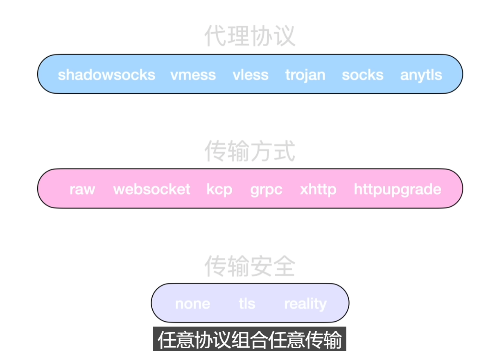

# 代理协议栈与工具参考

这一篇作为工具与协议的速查手册，按**代理协议栈分层（协议 / 传输 / 伪装安全）**、**服务端 TLS 与反向代理长连接配置要点**、以及**客户端订阅链接解析**三部分整理。

> 协议生态演进较快，以下协议栈格局基于 2026 年中期的实际主流生态整理。

---

## 一、代理协议栈全景



一套现代代理连接通常由三层拼接而成：**代理协议**（负责认证与转发语义）+ **传输层**（数据封装成什么连接形态发送）+ **伪装与安全层**（加密以及让外层流量像正常业务）。

### 1. 代理协议层

指客户端和远端代理服务端之间真正承载代理语义的协议：

- **VLESS**（热度：高，Xray 生态主力）
  - 轻量代理协议，只负责身份认证（UUID 用于识别用户）和代理语义，**本身不加密**，必须搭配 TLS 或 REALITY 等安全层。
  - V2Fly 侧已不推荐新部署，但 Xray 侧持续围绕它演进；老式纯 `VLESS + TLS + TCP` 已逐步淡出，当前主流组合是：
    - `VLESS + RAW(TCP) + REALITY + xtls-rprx-vision`
    - `VLESS + XHTTP + TLS/REALITY`
    - `VLESS + WS/gRPC + TLS`（传统形态，常见于机场与 CDN 节点）
  - 记忆要点：VLESS 只是骨架，真正决定可用性和伪装效果的是搭配的 REALITY / TLS / XHTTP。

- **Hysteria2**（热度：高，QUIC/UDP 系代表）
  - 基于 QUIC 的代理协议，同时处理 TCP 和 UDP 代理流量，抗丢包强、弱网速度优势明显；支持伪装成 HTTP/3 及 Salamander 混淆。
  - 限制：认证成功后会切换为自定义代理语义，不能像 WebSocket 那样直接套传统 HTTP CDN；且受运营商 UDP QoS 限速或阻断影响较大。
  - 适用场景：TCP 握手频繁失败、丢包严重的网络下优先尝试（前提是链路未封禁 UDP）。

- **TUIC v5**（热度：中高，QUIC 系代表）
  - 基于 QUIC 的 TCP/UDP 代理协议，强调 0-RTT、UDP 代理和连接迁移，设计偏简洁标准化。生态略小于 Xray，但 sing-box、mihomo 等主流内核均已支持。

- **Shadowsocks / Shadowsocks 2022**（热度：中）
  - 经典轻量加密代理协议。早期 SS 单独使用时抗探测能力有限；**Shadowsocks 2022** 补齐了防重放（Replay Protection）、UDP 会话管理和 BLAKE3 等现代设计，通常与 ShadowTLS 等外层伪装搭配使用。

- **Trojan**（热度：中）
  - 将代理流量伪装成标准 HTTPS 服务：客户端用密码认证，认证失败则回落到真实网站。需要真实域名与证书，直观稳定，但新特性生态不如 VLESS + REALITY / XHTTP 活跃。

- **VMess**（热度：低到中，偏遗留）
  - 早期 V2Ray 原生协议，自带加密与认证（新版为 AEAD，旧版 MD5 已淘汰），强依赖客户端与服务端时间同步。若外层再套 TLS 容易形成 TLS-in-TLS 双层加密特征，新部署通常优先选择 VLESS / Trojan / Hysteria2 / TUIC。

- **WireGuard**（热度：高，**L3 VPN 协议**）
  - 严格来说不是应用层代理，而是三层虚拟网卡隧道协议，接管 IP 层整机流量，轻量高效。原始 WireGuard 握手特征较明显，常见扩展方向是在外层套 TCP、QUIC、MASQUE、Shadowsocks 等混淆壳。

- **Juicity**（热度：低到中）：受 TUIC 启发的 QUIC 代理协议，侧重更稳定的 UDP 处理，客户端生态较小。

- **Mieru**（热度：低到中）：非 TLS 伪装路线代表——不依赖域名、证书和假站，目标不是伪装成 HTTPS，而是让流量难以被分类和探测（hard to classify / probe），支持 TCP/UDP。

### 2. 传输承载层

决定代理协议的数据具体包在什么连接形态里传输：

- **XHTTP**（热度：高，Xray 新一代 HTTP 传输层）
  - 旨在替代传统 WS / gRPC / HTTP 传输，支持 HTTP/1.1、HTTP/2、HTTP/3，可穿越各类 HTTP 中间盒、反向代理和 CDN。
  - 核心特性：支持上下行分离（上行和下行走不同路径）、Header Padding、XMUX 复用。虽然名字带 HTTP，但在代理体系里扮演的是**传输承载层**。
  - 三种模式：
    - `packet-up`：上行拆成多个 POST，下行流式 GET，兼容性最强；
    - `stream-up`：上行和下行均流式传输，效率更高；
    - `stream-one`：单个请求内完成双向流式传输。
- **RAW / TCP**（热度：高）：直接跑在原始 TCP 上（Xray 新版文档中 `tcp` 更名为 `raw`，两者兼容）。性能最好、封装开销最小，本身无伪装能力，需配合 TLS / REALITY（如 `VLESS + RAW + REALITY + Vision`）。
- **WebSocket**（热度：中）：把流量包进 WebSocket 长连接，最大优势是对各类 CDN 和老客户端兼容性极广，但特征较传统。
- **gRPC**（热度：中）：基于 HTTP/2 的传输方式，适合反代与 CDN；但长连接行为较固定，许多场景正逐步转向更灵活的 XHTTP `stream-up`。
- **HTTPUpgrade**（热度：中）：借用 HTTP Upgrade 机制建立传输，比 WebSocket 更轻，定位介于 WS 与 XHTTP 之间。
- **QUIC / HTTP/3**（热度：高）：基于 UDP 的现代传输底座，既可以直接承载 Hysteria2 / TUIC，也可以作为 XHTTP 走 HTTP/3 的底层传输；无 TCP 跨流队头阻塞且支持连接迁移，但受限于网络对 UDP 的友好度。

### 3. 伪装与安全层

回答“外层流量看起来像不像正常业务”以及“传输是否加密安全”：

- **REALITY**（热度：高）：Xray 的 TLS 伪装与认证方案，**无需自备域名和证书**。对外表现像访问真实目标站点，非法探测连接直接回落到目标站；依赖合理的 `serverName`、目标站、密钥和 `shortId` 配置。
- **TLS**（热度：高）：标准加密传输层，需要域名和有效证书，兼容性与过 CDN 能力最好。但仅开 TLS 不代表完全像真实浏览器，握手指纹和上层 HTTP 行为同样会影响特征。
- **uTLS 指纹**（热度：高）：在出站配置中指定模拟 Chrome、Firefox、Safari 等浏览器的 TLS `ClientHello` 指纹（如 `fingerprint: chrome`）。它解决的是“握手像浏览器”，不解决握手后的协议行为特征。
- **ECH（Encrypted Client Hello）**（热度：中高）：HTTPS 隐私演进标准，用于加密 TLS `ClientHello` 中的 SNI 等明文信息，实际生效依赖 DNS HTTPS 记录与服务端/客户端共同支持。
- **XTLS Vision**（热度：高）：Xray 的流控与优化模式（常见参数 `flow=xtls-rprx-vision`），常与 `VLESS + REALITY + RAW` 搭配，用于减少重复封装损耗并消除内层 TLS 特征。
- **ShadowTLS**（热度：中）：利用第三方可信证书的真实 TLS 握手做外层掩护，本身不加密业务数据，常配合 Shadowsocks 使用。
- **NaiveProxy**（热度：中）：直接复用 Chromium 真实网络栈（基于 HTTP/2 或 HTTP/3 `CONNECT`，服务端常配 Caddy forwardproxy / HAProxy），核心思路是直接用真 Chrome 栈来获得最自然的流量表现。
- **CDN / 反向代理**：属于部署架构层而非协议本身，用来隐藏源站真实 IP；它会反过来限定可用的传输层（传统 CDN 通常适配 WS / gRPC / XHTTP，不适合直接套 Hysteria2 / TUIC）。

### 4. 本地入站协议与 WebRTC 泄漏

- **本地入站（SOCKS5 / HTTP）vs 远端出站（VLESS / Trojan 等）**：
  - 代理软件同时存在“入站（Inbound）”和“出站（Outbound）”两头。
  - **SOCKS5** 是通用 L4/L5 转发协议，按 IP 和端口转发原始字节流；**HTTP 代理**则理解 HTTP 语义（`GET` / `CONNECT`）。两者通常用于**本机或局域网内部的入站监听**（对应环境变量里的 `http_proxy` / `all_proxy`），而 VLESS / Trojan / Hysteria2 等协议用于本机代理内核与远端公网服务器之间的加密出站。
- **WebRTC IP 泄漏**：
  - 浏览器的常规代理配置通常只接管 HTTP/HTTPS 流量，而 WebRTC 音视频通信发起的 **STUN 请求**（同属应用层协议，和 HTTP 平级）可能绕过代理直连公网，暴露本机真实出口 IP。
  - 可在 Chrome 等浏览器中通过隐私扩展限制 WebRTC 路由策略，并用 https://ippure.com/ 检测泄漏情况。

---

## 二、服务端必备：TLS 证书链与 Nginx 长连接反代要点

自建代理节点、Headscale/DERP 中继或 Web 反向代理时，有两个服务端配置坑极易引发诡异故障：

### 1. TLS 证书链完整度（为什么浏览器正常，`curl` 却报 `error 60`？）

HTTPS 校验依赖一条从站点证书一路回溯到系统内置根证书的信任链：

- **叶子证书（Leaf / Site Cert）** → **中间证书（Intermediate CA，可能 1~2 级）** → **根证书（Root CA，预装在操作系统里）**。
- **常见坑点**：如果服务端 Nginx / DERP 只配置了叶子证书（`cert.pem`）而漏掉了中间证书，桌面浏览器可能会偷偷根据证书里的 AIA 链接去网上自动补下中间证书，所以你用浏览器打开看起来完全正常；但 **Linux `curl`、Go 客户端、脚本程序不会自动补链**，直接报错 `curl: (60) SSL certificate problem: unable to get local issuer certificate`。
- **正确做法**：
  - 服务端始终部署包含叶子 + 全部中间证书的完整链（如 `fullchain.pem`）；
  - 使用 `acme.sh` 或 Certbot 签发（推荐现代 EC-256 证书）时，务必配好自动续签后的服务重载钩子（`--reloadcmd`），避免 90 天过期无人察觉。
- **快速验证命令**：
  ```bash
  openssl s_client -connect example.com:443 -servername example.com -showcerts </dev/null
  ```
  检查输出中的 `Certificate chain` 是否包含完整的各级证书，以及末尾 `Verify return code: 0 (ok)`。

### 2. Nginx 反向代理长连接与防坑清单

Nginx 默认参数是面向短连接静态网页设计的，用来反代 WebSocket、DERP 协议升级、SSE 流式接口或代理隧道时，必须显式调整以下几项：

| 配置项 | 默认坑点 | 推荐做法与原因 |
| :--- | :--- | :--- |
| **`proxy_buffering`** | 默认 `on`（攒够一块再发） | **设为 `off`**。长连接、隧道升级和流式响应绝不能被反代缓冲攒包，否则实时交互严重卡顿甚至协议握手超时 |
| **`proxy_read_timeout` / `proxy_send_timeout`** | 默认 `60s`（部分面板如 NPM 为 `90s`） | **拉大到长连接级别（如 `86400s`）**。否则长连接空闲一两分钟就会被 Nginx 主动掐断重连 |
| **`worker_connections`** | 默认常见仅 `512` | **调大（如 `4096`）**。每个反代连接在 Nginx 侧占 2 个连接槽位（客户端 + 上游），默认 512 极易被打爆踢人 |
| **`worker_shutdown_timeout`** | 默认不限（旧 worker 死等长连接关闭） | **设为合理上限（如 `30s`）**。否则每次 `nginx -s reload` 都会残留一批迟迟退不掉的僵尸旧 worker 进程 |
| **默认未匹配站点（Default Server）** | 误转发或自循环 | 监听默认 80/443 的兜底站点建议直接 **`return 444;`**（Nginx 专属静默断开，不回任何字节）。既能防公网 IP 盲扫，也能杜绝配置失误（如默认站点把 `/favicon.ico` 反向代理回 `127.0.0.1:80` 形成无限自循环瞬间打爆连接池） |

---

## 三、客户端订阅链接机制与解析（V2RayN / Clash / x-ui）

### 1. 内核配置 vs GUI 订阅链接

真正执行代理流量转发的是底层内核（如 **V2Ray / Xray** 使用 JSON 配置；**Clash / Mihomo** 使用 YAML 配置）。所谓的“分享链接”和“订阅链接”，本质是各个 GUI 客户端为了省去手工写 JSON/YAML 的麻烦而约定的便携格式，由 GUI 拉取后自动解析并生成底层内核配置。

### 2. 机场订阅链接的核心机制：按 `User-Agent` 动态分发

一个标准订阅链接本质就是一个指向纯文本资源的 HTTPS URL（类似 `raw.githubusercontent.com`）。**服务端会根据 HTTP 请求头里的 `User-Agent` 自动返回不同客户端格式的配置文件**：

```bash
# 模拟普通浏览器 / V2Ray 客户端请求 → 通常返回 Base64 编码的节点列表
curl -v "https://sub.example.com/s/xxxx"

# 模拟 Clash 客户端请求 → 通常直接返回明文 YAML 配置
curl -v -H "User-Agent: Clash/1.0" "https://sub.example.com/s/xxxx"
```

### 3. V2RayN `vmess://` 分享链接格式实测对照

`vmess://...` 格式最早由 V2RayN 推广，后来也被不少其他客户端兼容。不同格式在“剪贴板导入”和“URL 订阅拉取”上的支持情况存在明显差异：

| 序号 | 格式形态 | 示例 | 剪贴板导入 | URL 订阅拉取 | 备注 |
| :--- | :--- | :--- | :--- | :--- | :--- |
| 1 | `vmess://明文URL参数` | `vmess://1cf66be4-ffff-ffff-ffff-7e9e0b368cd0@1.2.3.4:10002?encryption=none&security=none&type=tcp&headerType=none#name` | 支持 | — | 最直观，手写/脚本拼接只需关注 IP、端口、UUID、加密与备注 |
| 2 | `vmess://Base64(URL参数)` | `vmess://MWNmNjZiZTQt...` | 不支持 | 支持 | URL 订阅可识别，直接粘贴剪贴板不行 |
| 3 | `Base64("vmess://明文URL参数")` | `dm1lc3M6Ly8xY2Y2...` | 支持 | — | 整条链接做一次 Base64 编码 |
| 4 | `Base64("vmess://Base64(URL参数)")` | `dm1lc3M6Ly9NV05t...` | 不支持 | 不支持 | 机场订阅外层也是双重 Base64，但内层 Base64 包的是 **JSON** 而非 URL 参数 |
| 5 | `vmess://明文JSON` | `vmess://{"v":"2","ps":"name",...}` | 解析错误 | — | 能导入但字段会错乱 |
| 6 | `vmess://Base64(JSON)` | `vmess://eyJ2IjoiMiIsInBzIjoi...` | **支持** | **支持** | V2RayN 经典标准分享格式 |

### 4. 从 `x-ui` 数据库直接导出节点链接

面板工具 `x-ui`（及 `3x-ui`）把全部入站节点配置保存在本地 SQLite3 数据库（`x-ui.db`）的 `inbounds` 表中，可以直接写脚本读取并拼接分享链接。

**Rust 读取示例（`rusqlite`）**：

```rust
use rusqlite::{Connection, Result};

const XUI_DB_PATH: &str = "x-ui.db";

fn main() -> Result<()> {
    let conn = Connection::open(XUI_DB_PATH)?;
    let mut stmt_inbounds = conn.prepare("SELECT * FROM inbounds")?;
    let inbounds_iter = stmt_inbounds.query_map([], |row| {
        let remark: Option<String> = row.get(5)?;
        Ok(remark)
    })?;
    for inbound in inbounds_iter {
        if let Ok(remark_option) = inbound {
            match remark_option {
                Some(remark) => println!("Remark: {}", remark),
                None => println!("Remark is empty (NULL)"),
            }
        }
    }
    Ok(())
}
```

**Python 解析并导出链接示例**：

```python
import json
import sqlite3

def read_db(xui_db_path: str, server_ip: str):
    conn = sqlite3.connect(xui_db_path)
    cursor = conn.cursor()
    # 读取 inbounds 表（存储全部入站节点配置）
    cursor.execute("SELECT * FROM inbounds;")
    for inbound in cursor.fetchall():
        remark = inbound[5]
        port = inbound[12]
        protocol = inbound[13]
        if inbound[14]:  # settings JSON 字段
            try:
                settings = json.loads(inbound[14])
                for client in settings.get("clients", []):
                    uuid = client.get("id")
                    one_url = (
                        f"{protocol}://{uuid}@{server_ip}:{port}"
                        f"?encryption=none&security=none&type=tcp&headerType=none#{remark}\n"
                    )
                    with open("./result.txt", "a") as f:
                        f.write(one_url)
            except json.JSONDecodeError as e:
                print(f"解析配置错误：{e}")
```
