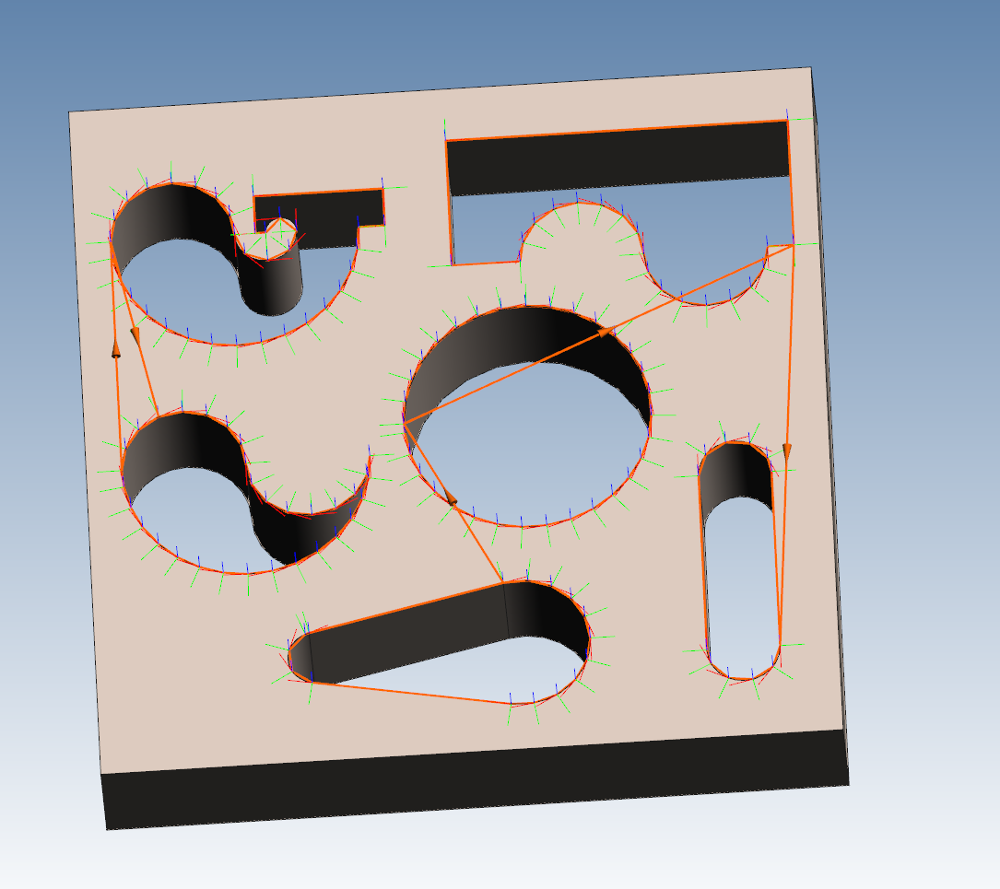
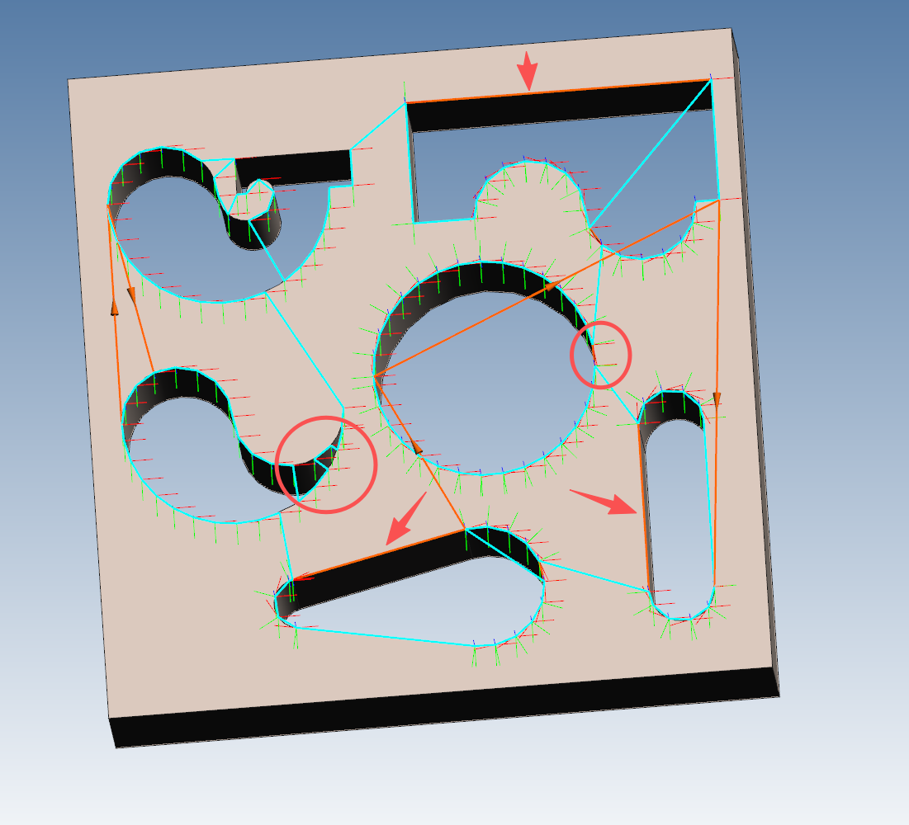
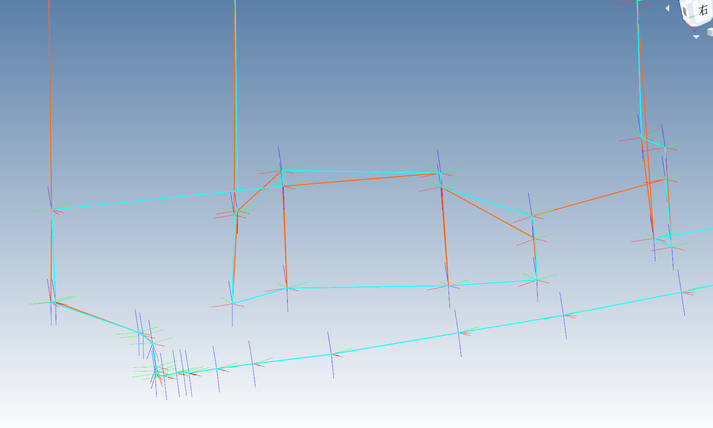
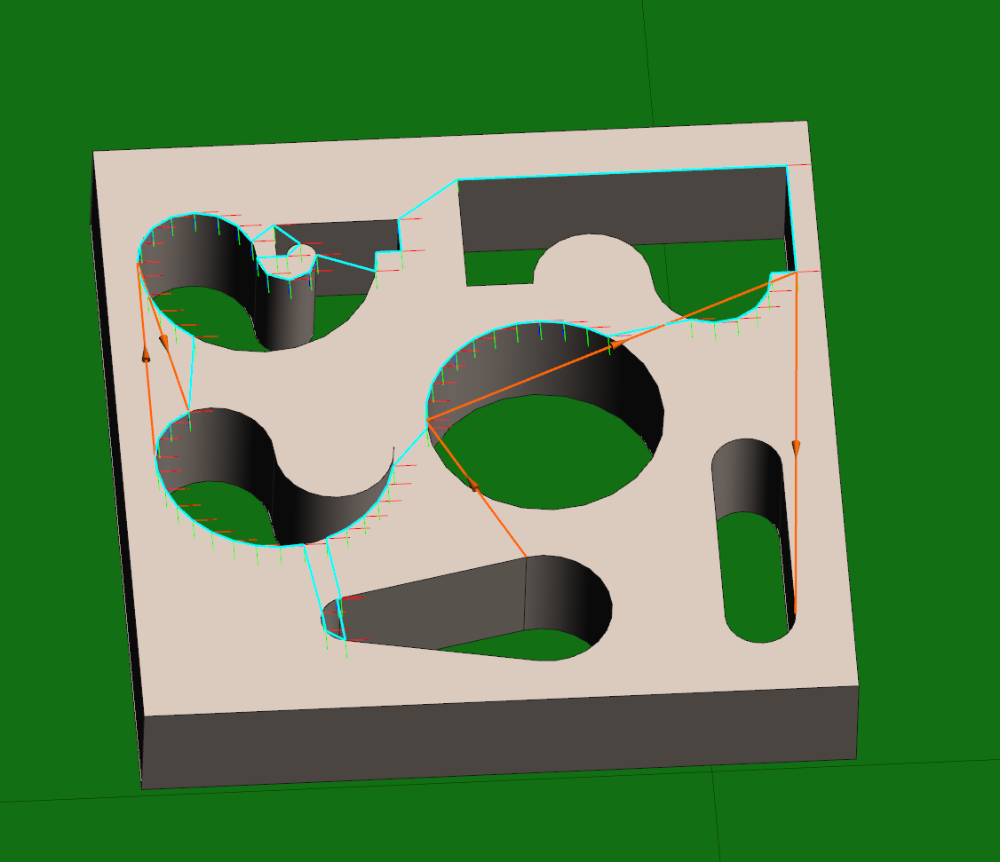
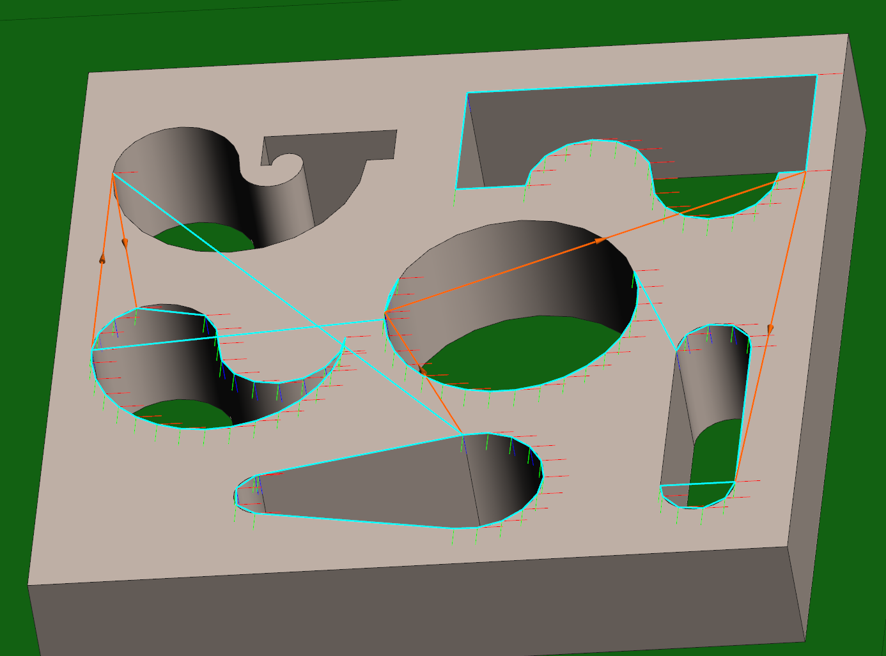
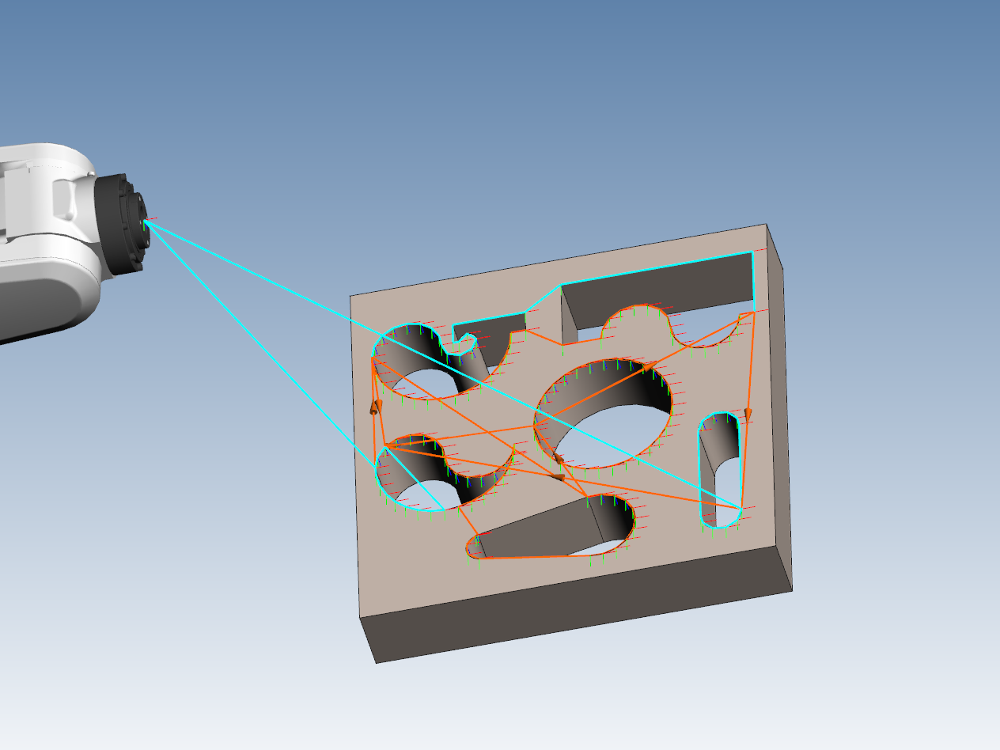

# 运筹优化与工业路径规划：TSP、VRP 与 OR-Tools 焊接轨迹实战

在工业机器人（如白车身多机器人协同点焊、弧焊）与物流调度中，经常需要求解 旅行商问题（TSP）、多旅行商问题（MTSP）以及它的进阶形态 车辆路径规划问题（VRP, Vehicle Routing Problem）。

这类组合优化问题可以使用 Google 开源的运筹学求解器 OR-Tools 来求解（官方文档极其详尽，上手跑通基础 Demo 非常快）。这篇笔记保留并整理了将 OR-Tools 真正落地到工业焊接机器人轨迹规划时，遇到的五个核心几何与物理难题及其实战解法。

---

## 一、从经典算法到 TSP 问题的几何直觉

### 1. 图论与路径搜索中的几个基础算法定位

在进入 TSP 之前，先用一句话分清图论里最常提到的四个基础算法各自干什么：
- 最小生成树 MST（Prim 算法、Kruskal 算法）：在一个给定无向图里，用最小的总造价修路，把所有城市连通起来（注意它长出来的是一棵没有环的“树”，允许分叉，而不是一条一笔画走完的路线）。
- **Dijkstra（迪杰斯特拉）与 A*（A-Star）：求的是从单一指定起点到单一指定终点**的两点间最短避障路径。
- **TSP（旅行商问题）**：要求把地图上给定的 N 个目标点全部恰好访问一次，且走过的总路程最短。
- **2-opt 局部搜索启发式算法**：解平面欧氏距离 TSP 最经典的一招——因为在二维平面内，由于“三角形两边之和大于第三边”，任何一条最优的欧氏平面 TSP 路线，在几何上必定是没有任何线段自相交的（近似构成一个简单多边形轮廓）。只要发现当前路线里有两段边交叉成了“X”形，用 2-opt 把交叉解开重连，总路程几乎一定能变得更短。

### 2. 闭环 TSP vs 开环（固定/任意起终点）TSP

在调用 OR-Tools 的 `RoutingIndexManager(num_nodes, num_vehicles, depot)` 时，TSP 分为两类建模方式：
1. **经典闭环 TSP（要求最后必须回到起点）**：
   既然最后一定要连回起点构成一个封闭的圈，那“从圈上的哪一个点作为 0 号起点出发”其实对求出来的最优环路没有任何影响，随便指定 0 号点作为仓库起点（Depot）即可。
2. 开环路径（只要求把所有点走完一遍，不要求连回起点，甚至起点和终点随意）：
   - 如果机器人的出发过渡点（Start）和收工过渡点（End）是明确固定的，且就在这 N 个点里，直接在构造 `RoutingIndexManager` 时分别传入 `starts` 和 `ends` 索引数组即可。
   - 如果希望求解器自己挑一个最顺手的点开始、走完最后一个点就直接停下（任意起终点）：
     标准技巧是引入一个“虚拟起始点（Dummy Depot）”——把原本 $N \times N$ 的距离矩阵在思想上扩充为 $N + 1$，并规定这个虚拟点到所有真实工作点之间的往返距离全部为 `0`（在代码实现上，甚至不需要真的去重新分配 $N+1$ 的二维数组，因为 OR-Tools 的距离是通过你注册的回调函数查询的，只需在回调函数里写一行：凡是查询索引越过 $N$ 碰到虚拟点的，一律直接 `return 0` 即可）。这样求解器算出来的闭环里，被虚拟点以 0 代价连接的那一头一尾两个真实点，自然就是全局最省路程的自由起点和自由终点。
   - **真实工业场景的 N+2 建模**：在实际工业产线上，机器人往往需要从固定的安全过渡点（Home 点）出发去干活，干完所有焊点后再回到过渡点。最稳妥的做法是直接把每台机器人的真实物理起点和终点显式加入点集（矩阵变为 $N + 2$），把起点到各个焊点的真实距离算进去。

---

## 二、单旅行商（单机规划）在工业轨迹上的两大缺陷与解法

如果直接把工件上的一堆离散目标点丢给 OR-Tools，什么特殊约束都不加，算出来的单机路径在工业现场会立刻暴露出两个严重问题：



### 1. 问题一：局部圆环无法闭合，出现被劈开的“缺口”

如上图中间的那个圆形焊缝，我们期望机器人走到圆环附近时，顺着圆环一气呵成焊完一整圈再离开；但直接跑出来的全局 TSP 结果却是下面这样——圆环被撕开了一个缺口（如果是双机器人，求解器甚至特别喜欢让左右两台机器人一人抄圆环的左半圈、一人抄右半圈）：



- **根因**：在标准 TSP 眼里，圆环上的 20 个离散点和外面的点是完全平级的，它为了贪图全局进出那几毫米的折返距离最优，很自然就会在去程顺路扫半个圆，回程再扫另外半个圆。
- **工程解决方案（两阶段质心聚合）**：
  1. **第一阶段（粗规划）**：凡是工艺上要求必须连续走完的局部闭环 Path，先求出这组点的几何质心（Centroid），把整条圆环收缩聚合成 1 个“大城市节点”参与全局 TSP 求解；
  2. **第二阶段（细展开）**：等全局粗规划决定了“先去 A 点 $\rightarrow$ 再来这个圆环聚合点 $\rightarrow$ 接着去 B 点”之后，再根据前驱点 A 和后继点 B 的方位，在圆环内部挑选最顺路的切入点和切出点将其展开。虽然牺牲了一丁点理论上的全局极限最短距离，但 100% 保证了局部圆环工艺的完整性。

### 2. 问题二：在锐角三角形尖点或密集平行轨迹处“左右横跳”

当一条连续轨迹遇到锐角折返（尖点），或者像下图这种需要按“弓字形 / 之字形”连续推进的焊接路径时：



如果只按空间欧氏距离最短去求 TSP，求解器在锐角尖点处极易发生左右交替横跳，或者在弓字形轨迹里为了走直线近道而直接跳过中间的焊点顺序！

针对这个现象的两种解决思路与深层反思：
1. **引入机器人工具姿态的真实物理代价**：
   机器人在相邻点之间移动，代价不只是空间直线距离，还包括焊枪工具姿态旋转的代价（比如在尖点处左右横跳会导致焊枪末端频繁翻转 180°，耗时极长）。把关节旋转耗时算进代价矩阵，能自动抑制一部分尖点横跳（但代价是前期两两计算逆运动学与姿态耗时的计算量会陡增）。
2. 对同一条预设轨迹内部的相邻点乘以 `0.1` 的引导系数：
   如果仅用位置距离，对于原本就属于同一条连续焊缝 Path 上的第 $i$ 个点和第 $i+1$ 个点，我们在距离矩阵里人为给它的转移代价乘上一个很小的权重系数（比如 `0.1`）。这样求解器一旦进入这条轨迹的一端，就会像吸铁石一样顺着 `0.1` 的低代价通道老老实实把整条弓字形或尖点轨迹按序走完，绝不会半途跳去别处。
   - **当时的工程反思**：如果一条弓字形轨迹必须靠给相邻点硬塞 `0.1` 的系数来强行保住它原本的先后顺序，那把这条轨迹内部的所有点拆散丢进 TSP 的意义其实就不大了——更合理的架构是直接把一条固定顺序的连续轨迹缩成“一头一尾两个端点（固定内部耗时）”去参与宏观顺序重排，而不是把几百个内部顺序早已锁死的密集插补点全扔给 TSP 求解器。

---

## 三、多旅行商（双机器人协同规划）的负载均衡与防碰撞

当把问题升级为 2 台焊接机器人同时在一块工件上干活（MTSP / VRP）时，新的麻烦立刻出现了。

### 1. 为什么求解器默认会让“一台累死、另一台站在原地看戏”？

如果在 OR-Tools 里只是把车辆数 `num_vehicles` 设为 `2`，并且给每台机器人的最大允许工作时间上限（Capacity / Horizon）设得很大，跑出来的结果一定是：1 号机器人一口气把全场所有点全焊完了，2 号机器人一步不动（耗时为 0）！

- **根因**：TSP / VRP 的默认默认优化目标是“所有机器人的总移动路程之和最小”。从几何上看，让 1 台机器人一笔画走完所有点，肯定比让 2 台机器人分别从各自基地出发再回来省去了第二台机器人的往返路程！
- 实现双机负载均衡（Min-Max 时间跨度）的两种方案：
  1. **方案 A（两遍求解法，速度极快）**：
     - 第一遍：先故意只放 1 台机器人进去跑一遍单机 TSP，极快地评估出干完所有活的总代价 $T_{\text{total}}$；
     - 第二遍：求出单机均摊耗时 $T_{\text{avg}} = T_{\text{total}} / 2$，然后给每台机器人的 `Time` 维度设置一个略带余量的硬上限（比如 **`1.3 * T_avg`**），再跑第二遍双机求解。因为 1 台机器人装不下超过 `1.3` 倍均值的活，求解器就会被逼着把任务均匀分给两台机器人！
  2. 方案 B（开启 OR-Tools 的全局跨度惩罚系数 `SetGlobalSpanCostCoefficient`）：
     在 OR-Tools 的时间维度（Dimension）上直接惩罚“干得最慢的那台机器人的总耗时”：

     ```cpp
     RoutingDimension* mut_time_dimension = m_uptrRouting->GetMutableDimension("Time");
     // 设置一个较大的全局跨度代价系数（如 100），迫使求解器压平两台机器人的最大完成时间差
     mut_time_dimension->SetGlobalSpanCostCoefficient(100);
     ```

     注意：加上全局跨度系数后，问题的数学搜索空间会变得极其陡峭，求解耗时显著增加，此时必须给求解器配置更长的搜索时间上限（Time Limit）让局部搜索充分迭代，才能跑出漂亮均衡的双机路线。

对比开启负载均衡与轨迹内 `0.1` 连续系数前后的双机规划效果：


*上图：双机器人均衡分配，但未加轨迹内连续系数时仍存在局部交叉跳跃*


*上图：双机器人 + 相邻轨迹点设置 0.1 引导系数后，两条路线各自平滑连续*

### 2. 双机空间分区与碰撞死锁问题

即便我们把左右两台机器人的物理真实起点（过渡点）加入到了 $N + 2$ 矩阵里，原本指望“左边出发的机器人自然只干左半场的活，右边出发的只干右半场的活”，但实际跑出来却经常出现下面这种极其危险的拓扑：一台机器人跑去走外圈大环，另一台机器人钻进内圈干活：



在真实的机械臂物理空间里，一个走外圈、一个走内圈意味着两台机械臂的底座与大臂在空间中必然发生物理干涉碰撞！
这说明：单纯靠“起点距离远近”的软代价，在全局总距离最优的诱惑面前是拉不住机器人的；在工业多机协同中，必须先在几何上按左右工位做硬性的空间区域划分（Clustering / 划定各自的禁入半平面或安全包络区），或者引入带时间窗的动态碰撞检测，绝不能指望纯距离 VRP 求解器自己领悟物理防撞。

### 3. 关于 VRP 求解器的多线程并行计算

为什么跑 OR-Tools 的 VRP 局部搜索时，看着 CPU 只有一个核在 100% 满载，没法直接把单次迭代拆成多线程加速？
- 因为 VRP 的元启发式搜索（Guided Local Search / 模拟退火 / 禁忌搜索）本质上是马尔可夫链式的逐步迭代——第 $k+1$ 步的邻域跳变强依赖于第 $k$ 步走出来的当前解状态，在微观单条搜索链上天然是串行的。
- 想要利用多核 CPU 做并行加速，只能在宏观层面动手：
  1. 多进程 / 多线程跑不同的随机种子（Multi-Seed / 不同初始解策略）：开 8 个线程，分别用不同的 `FirstSolutionStrategy`（如 `PATH_CHEAPEST_ARC`、`CHRISTOFIDES`、`PARALLEL_CHEAPEST_INSERTION`）或不同扰动参数同时独立搜索，最后取 8 个线程里算出来的最优解；
  2. 分治拆解（Divide and Conquer）：先利用空间聚类把几千个点的大问题拆成几个互不干扰的子区域，每个线程各自独立求解一个子区域的 TSP，最后再把子区域首位相连。
